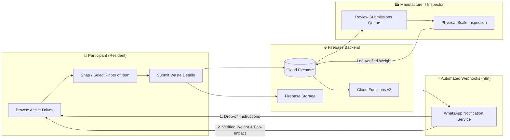

# 🌱 Emma - Community Waste Drive & Upcycling Platform

[](https://flutter.dev)
[](https://dart.dev)
[](https://firebase.google.com)
[](https://riverpod.dev)
[](https://flutter.dev)

**Emma** is a cross-platform, community-driven sustainability application engineered to bridge the gap between local residents and certified recycling manufacturers through organized e-waste and recyclable machinery collection drives. Built using **Flutter**, **Firebase**, and **Riverpod**, Emma provides an end-to-end transparent pipeline for scheduling drives, capturing submissions with photo verification, weighing items at drop-off, tracking real-time eco-impact metrics, and triggering automated WhatsApp notifications via **n8n** and **Firebase Cloud Functions**.

---

## 🌟 Key Highlights & Architecture



---

## 📱 User Roles & Feature Breakdown

### 1. 👥 Participant (Resident) Flow
* **Live Eco-Impact Dashboard:**
  * Real-time metrics tracking: **Personal Recycled Weight (kg)**, **CO₂ Emissions Diverted**, and **Tree Equivalents**.
  * Dynamic list of upcoming waste drives filtered by neighborhood, target capacity, and accepted categories.
* **Camera Capture & Registration:**
  * Auto-populates participant name, contact phone, and email from authenticated profile.
  * Multi-category selector: Laptops, Home Appliances, Industrial Batteries, Telecom Gear, Mixed Cables, and more.
  * Direct camera capture or photo gallery upload powered by `image_picker`.
  * Uploads photos directly to Firebase Storage (`/waste_items/{driveId}/{submissionId}.jpg`).
* **Submission Confirmation & Tracking:**
  * Generates unique submission reference IDs with immediate drop-off guidance.
  * Real-time submission state badges: `Pending Weight` *(amber)* ➔ `Verified: X kg` *(emerald green)*.

### 2. 🏭 Manufacturer / Recycling Facility Flow
* **Manufacturer Hub & Drive Switcher:**
  * Toggle between assigned collection drives to monitor live participant intake.
  * High-level analytics: Verified Tonnage, Items Pending Inspection, Unique Contributors, and Target Progress %.
  * Filter submissions seamlessly: `All`, `Pending`, or `Verified`.
* **Inspection & Lightbox Review:**
  * Participant cards with full contact info, notes, timestamp, and high-resolution photo.
  * Full-screen interactive zoom lightbox (`ItemImageViewer`) to inspect item condition prior to weighing.
* **Scale Check & Weight Logging:**
  * Physical scale inspection dialog (`WeightEntryDialog`) supporting instant **KG ⇄ LBS** unit toggling.
  * Add inspector notes and commit verified weight directly into Cloud Firestore in real time.

### 3. 📊 Developer & Platform Analytics Hub
* **Aggregate Impact Calculations:**
  * Overall diverted tonnage across all municipal collection drives.
  * Global CO₂ offset algorithm ($1.44\text{ kg CO}_2\text{ saved per kg e-waste diverted}$).
  * Landfill volume conserved ($m^3$) and tree equivalence formulas.
* **Real-time Observability:**
  * Live visual photo feed of all inbound community submissions.
  * Interactive JSON document inspector streaming live Firestore updates across `drives`, `drive_submissions`, and `users`.

### 4. ⚡ Automation & Webhook Integration (n8n + WhatsApp)
* **Direct Webhook Service (`lib/services/webhook_service.dart`):** Dispatches asynchronous HTTP payloads on key app milestones.
* **Cloud Functions v2 (`functions/src/index.ts`):** Firestore event triggers:
  1. `onDriveSubmissionCreated`: Sends registration confirmation and drop-off directions.
  2. `onDriveSubmissionUpdated`: Sends instant verification alert with logged weight and total CO₂ offset once verified by the manufacturer.

---

## 📂 Project Directory Structure

```
emma_drive/
├── android/                      # Android native configuration & Gradle scripts
├── assets/
│   └── images/
│       └── logo.png              # Emma brand identity logo
├── functions/                    # Firebase Cloud Functions (v2 TypeScript)
│   ├── src/
│   │   └── index.ts              # Firestore triggers for n8n webhooks
│   ├── package.json
│   └── tsconfig.json
├── ios/                          # iOS configuration & Runner workspace
├── lib/
│   ├── config/
│   │   └── app_theme.dart        # Eco-conscious dark theme, palette & typography
│   ├── firebase_options.dart     # Multi-platform FlutterFire configuration
│   ├── main.dart                 # Application entry point with Riverpod ProviderScope
│   ├── models/
│   │   ├── drive_model.dart      # Drive entity & target weight models
│   │   ├── drive_submission_model.dart # Waste submission & status tracking
│   │   └── user_model.dart       # User entity & role definitions (Participant vs Manufacturer)
│   ├── providers/
│   │   ├── analytics_provider.dart # Aggregated eco-metrics & real-time formulas
│   │   ├── auth_provider.dart    # User session notifier
│   │   └── drive_provider.dart   # Real-time drive & submission streams
│   ├── screens/
│   │   ├── auth/
│   │   │   └── auth_screen.dart  # Sign-in/registration with one-click demo profiles
│   │   ├── developer/
│   │   │   └── developer_analytics_screen.dart # Real-time system monitoring
│   │   ├── manufacturer/
│   │   │   ├── manufacturer_dashboard_screen.dart # Intake & queue management
│   │   │   └── weight_entry_dialog.dart           # Scale inspection dialog
│   │   ├── participant/
│   │   │   ├── participant_home_screen.dart       # Resident dashboard & impact stats
│   │   │   ├── participant_registration_dialog.dart # Photo submission modal
│   │   │   └── submission_success_screen.dart     # Confirmation & drop-off ticket
│   │   └── splash_screen.dart    # Animated launch screen with role-aware routing
│   ├── services/
│   │   ├── auth_service.dart     # Firebase Auth with local demo fallback
│   │   ├── firestore_service.dart# Firestore streams and document transactions
│   │   ├── mock_data_service.dart# Reactive memory fallback & demo data seeds
│   │   ├── storage_service.dart  # Firebase Storage photo uploader
│   │   └── webhook_service.dart  # n8n webhook dispatcher
│   └── widgets/
│       ├── emma_logo_widget.dart # Official brand logo component
│       ├── item_image_viewer.dart# Zoomable photo lightbox
│       ├── stat_card.dart        # Glassmorphism metrics card
│       └── status_badge.dart     # Verification status pill
├── test/
│   ├── models_and_services_test.dart # Unit tests for domain models & seed streams
│   └── widget_test.dart          # Widget mount & navigation smoke test
├── pubspec.yaml                  # Project dependencies & asset declarations
└── README.md
```

---

## 🛠 Tech Stack & Dependencies

| Category | Technology | Purpose |
| :--- | :--- | :--- |
| **Framework** | [Flutter](https://flutter.dev) (Dart ^3.11.3) | Multiplatform UI engine |
| **State Management** | [flutter_riverpod](https://pub.dev/packages/flutter_riverpod) | Reactive state management & dependency injection |
| **Authentication** | [firebase_auth](https://pub.dev/packages/firebase_auth) | User identity & authentication |
| **Database** | [cloud_firestore](https://pub.dev/packages/cloud_firestore) | Real-time NoSQL cloud database |
| **Cloud Storage** | [firebase_storage](https://pub.dev/packages/firebase_storage) | Item photo storage |
| **Backend Triggers**| [Firebase Functions v2](https://firebase.google.com/docs/functions) | TypeScript Cloud Functions for background events |
| **Automation** | [n8n](https://n8n.io) | WhatsApp notification dispatch workflows |
| **Media & UI** | `image_picker`, `flutter_animate`, `google_fonts` | Smooth camera UX, animations & styling |

---

## 🚀 Getting Started

### 1. Prerequisites
* [Flutter SDK](https://flutter.dev/docs/get-started/install) (`>= 3.11.3`)
* [Node.js](https://nodejs.org/) (`v20+` for Firebase Cloud Functions)
* [Firebase CLI](https://firebase.google.com/docs/cli) (`npm install -g firebase-tools`)

### 2. Clone the Repository
```bash
git clone https://github.com/ndisha296/Emma_drive.git
cd Emma_drive
```

### 3. Install Dependencies
```bash
flutter pub get
```

### 4. Firebase Configuration
The application is pre-configured with Firebase project `emma-a3cbd`. If deploying to your own Firebase project:
```bash
firebase login
flutterfire configure --project=YOUR_PROJECT_ID
```

### 5. Configure n8n Webhook (Optional)
To enable real-time WhatsApp alerts:
1. In `lib/services/webhook_service.dart`, update:
   ```dart
   String n8nWebhookUrl = 'https://YOUR_N8N_INSTANCE.com/webhook/emma-whatsapp-webhook';
   ```
2. In `functions/src/index.ts`, update:
   ```typescript
   const N8N_WEBHOOK_URL = "https://YOUR_N8N_INSTANCE.com/webhook/emma-whatsapp-webhook";
   ```
3. Deploy Firebase Cloud Functions:
   ```bash
   cd functions
   npm install
   npm run deploy
   ```

---

## 💻 Running the Application

### Run on Chrome (Web)
```bash
flutter run -d chrome
```

### Run on Windows Desktop
```bash
flutter run -d windows
```

### Run on Android Device / Emulator
```bash
flutter run -d android
```

### Build Production Release APK
```bash
flutter build apk --release
```
*The resulting APK will be generated at `build/app/outputs/flutter-apk/app-release.apk`.*

---

## 🧪 Testing

Execute the comprehensive test suite verifying domain models, serialization, state mutations, and mock services:
```bash
flutter test
```

---

## 👥 Demo Credentials

For quick local evaluation without setting up new accounts, one-click demo credentials are built into the login screen:
* **Participant:** `Jane Doe` (`jane.doe@example.com`)
* **Manufacturer:** `Revive Tech Solutions` (`revive.tech@example.com`)

---

## 📄 License
This project is licensed under the MIT License - see the LICENSE file for details.
